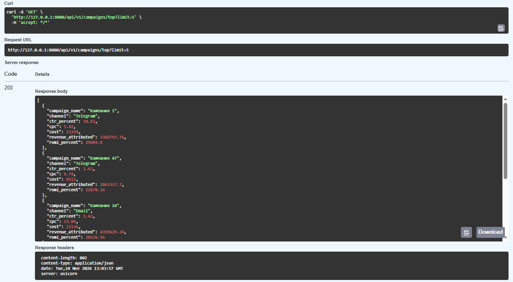
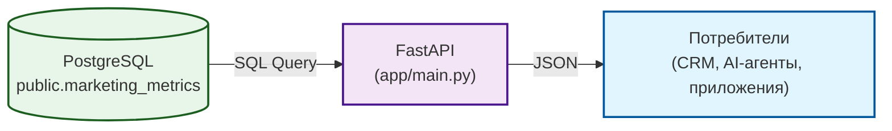

# 🚀 Marketing Analytics API

Pet-проект: REST API на **FastAPI** для отдачи маркетинговых метрик (ROMI, CTR, CPC) из DWH в формате JSON. Демонстрирует паттерн **Data-as-a-Service (DaaS)** для аналитических витрин.

## 📸 Скриншот

**Swagger UI с реальным ответом API:**


## 🎯 Зачем это

В маркетинговой аналитике часто нужно отдавать данные не в дашборд, а в другие системы (CRM, мобильное приложение, AI-агент). Этот проект показывает, как обернуть витрину `marketing_metrics` (из проекта `marketing-analytics-demo`) в REST API, чтобы любые сервисы могли получать метрики в JSON.

## 🏗 Архитектура



## 📂 Структура

```
marketing-analytics-api/
├── app/
│   ├── __init__.py
│   ├── database.py       # Подключение к PostgreSQL
│   ├── main.py           # FastAPI приложение и эндпоинты
│   └── schemas.py        # Pydantic-модели
├── assets/
│   └── api_response.png  # Скриншот Swagger UI
├── README.md
└── requirements.txt
```

## 🔌 Эндпоинты API

| Метод | Путь | Описание |
| :--- | :--- | :--- |
| `GET` | `/health` | Проверка живости сервиса и БД. |
| `GET` | `/api/v1/campaigns/top?limit=10` | Топ-N кампаний по ROMI. |
| `GET` | `/api/v1/stats/overall` | Общая статистика (средний CTR, ROMI, выручка). |
| `GET` | `/api/v1/campaigns/by-channel/{channel}` | Кампании по конкретному каналу (Telegram, VK, Email). |

## 🚀 Запуск

1. Установи зависимости:
```bash
pip install -r requirements.txt
```

2. Запусти API:
```bash
uvicorn app.main:app --reload
```

3. Открой Swagger UI: `http://127.0.0.1:8000/docs`.

## 📊 Результаты

- **API успешно подключается** к PostgreSQL и отдает данные из витрины `marketing_metrics`.
- **4 эндпоинта** (health, top campaigns, overall stats, by channel).
- **Swagger UI** автоматически генерирует документацию с описанием полей.

## 🔗 Связанные проекты

- [`marketing-analytics-demo`](https://github.com/nconichtchenko-arch/marketing-analytics-demo) — источник данных (витрина `marketing_metrics`).
- [`data-as-a-service-api`](https://github.com/nconichtchenko-arch/data-as-a-service-api) — аналогичный API для DWH.

## 📫 Контакты

- **GitHub:** [github.com/nconichtchenko-arch](https://github.com/nconichtchenko-arch)
- **Email:** pavloni@mail.ru
- **Формат работы:** удалённо